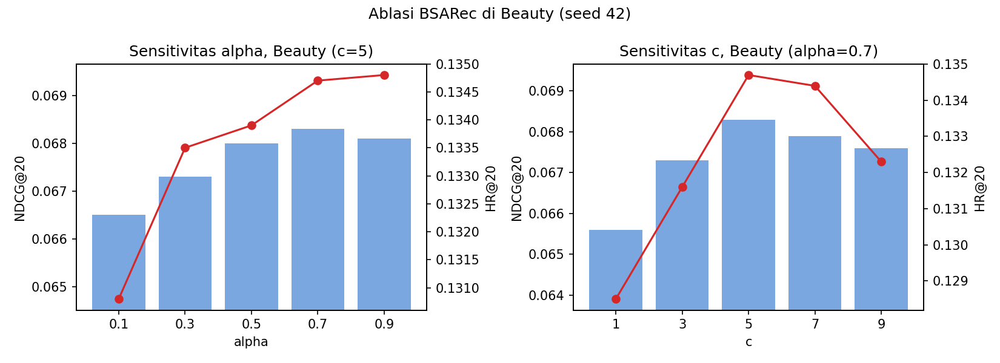

# BSARec_Reproduce

Reproduksi paper **"An Attentive Inductive Bias for Sequential Recommendation beyond the Self-Attention"** (BSARec, Shin, Choi, Wi, dan Park, AAAI 2024; [arXiv:2312.10325](https://arxiv.org/abs/2312.10325)) pada Amazon Beauty, LastFM, dan MovieLens-1M, untuk Checkpoint 1 probation Lab KC (Lab Sistem Cerdas), FILKOM, 2026. Tim: Anca dan Renno.

Repositori ini **tidak menyalin kode model atau dataset upstream**. Isinya notebook eksperimen, ringkasan hasil CSV, grafik, sebagian log, patch W&B, dan slide Checkpoint 1. Audit LastFM mencatat commit upstream BSARec `c80bdc0f1a889b78fe9a27e2058389cc84caea84`; commit saat training Beauty dan ML-1M tidak dicatat terpisah. Kode upstream: <https://github.com/yehjin-shin/BSARec>.

## Ringkasan hasil (Beauty)

Angka rata-rata 3 seed (42, 43, 44), dibandingkan dengan Table 2 paper. Detail per seed ada di `results/`.

| Metrik | BSARec paper | BSARec kami | Gap | SASRec paper | SASRec kami | Gap |
| --- | --- | --- | --- | --- | --- | --- |
| HR@5 | 0,0736 | 0,0703 | -4,5% | 0,0340 | 0,0341 | +0,2% |
| NDCG@5 | 0,0523 | 0,0501 | -4,1% | 0,0221 | 0,0218 | -1,2% |
| HR@10 | 0,1008 | 0,0980 | -2,8% | 0,0531 | 0,0533 | +0,4% |
| NDCG@10 | 0,0611 | 0,0591 | -3,3% | 0,0283 | 0,0280 | -1,1% |
| HR@20 | 0,1373 | 0,1334 | -2,8% | 0,0823 | 0,0823 | 0,0% |
| NDCG@20 | 0,0703 | 0,0680 | -3,3% | 0,0356 | 0,0353 | -0,8% |

- Evaluasi checkpoint resmi penulis (`BSARec_Beauty_best`) menghasilkan angka yang sama dengan Table 2 paper. Ini mendukung kesesuaian perhitungan metrik pada checkpoint tersebut, tetapi sendiri tidak membuktikan seluruh pipeline reproduksi.
- BSARec hasil latihan kami konsisten 2,8% sampai 4,5% di bawah paper; penyebabnya **belum teruji** (dugaan: perbedaan versi library dan GPU, lihat bagian lingkungan).
- SASRec sangat sensitif terhadap seed (std HR@5 0,0035); rata-rata tiga seed hampir sama dengan paper.
- BSARec mengungguli SASRec 62% sampai 130% di reproduksi kami (paper: 67% sampai 137%).

### Ablasi alpha dan c (satu seed, 42)



Alpha besar lebih baik dan mendatar di 0.5 sampai 0.9; c terbaik di 5 sampai 7. Dengan satu seed per titik, hanya alpha = 0.1 dan c = 1 yang bedanya cukup jelas dari noise antar seed (std HR@20 sekitar 0,0013). Tabel lengkap: `results/ablation_alpha_beauty.csv` dan `results/ablation_c_beauty.csv`.

## LastFM (3 seed)

Notebook utama menggunakan konfigurasi 4 worker. Output preprocessing yang tersimpan mencatat kecocokan urutan dan pemetaan referensi untuk 1.090/1.090 pengguna, serta lolosnya pemeriksaan 5-core, artis unik per pengguna, timestamp monoton, gap, dan serialisasi. Audit mencatat commit upstream BSARec `c80bdc0f1a889b78fe9a27e2058389cc84caea84`. Output preview baris mentah sengaja dihapus dari salinan notebook publik; dataset dan file checkpoint tidak ikut di-commit.

Rata-rata test 3 seed dibandingkan dengan Table 2 paper:

| Metrik | BSARec paper | BSARec 4 worker | Gap | SASRec paper | SASRec 4 worker | Gap |
| --- | ---: | ---: | ---: | ---: | ---: | ---: |
| HR@5 | 0,0523 | 0,0504 | -3,57% | 0,0413 | 0,0489 | +18,48% |
| NDCG@5 | 0,0344 | 0,0347 | +0,97% | 0,0284 | 0,0351 | +23,47% |
| HR@10 | 0,0807 | 0,0734 | -9,05% | 0,0633 | 0,0654 | +3,37% |
| NDCG@10 | 0,0435 | 0,0422 | -3,07% | 0,0355 | 0,0404 | +13,80% |
| HR@20 | 0,1174 | 0,1110 | -5,42% | 0,0927 | 0,0936 | +0,97% |
| NDCG@20 | 0,0526 | 0,0517 | -1,77% | 0,0429 | 0,0475 | +10,72% |

BSARec menang pada HR@10, HR@20, dan NDCG@20 di ketiga seed; hasil HR@5 dekat dan NDCG@5 bervariasi antar-seed. File [delta per seed](results/lastfm_paired_seed_deltas.csv) memberi hitungan lengkap.

Ada juga hasil SASRec 2-worker dari notebook W&B tambahan. Rata-ratanya berbeda dari 4-worker pada semua enam metrik, tetapi ini **bukan uji kausal jumlah worker**: notebook dan patch berbeda, dan belum ada kontrol ulang seed 42 pada 2 worker. Angka tersebut hanya perbandingan deskriptif; rinciannya ada di [CSV sensitivitas worker](results/sasrec_lastfm_worker_sensitivity.csv).

Timestamp LastFM di sini berasal dari event tag, bukan riwayat scrobble/dengarkan musik. Notebook mencatat 44.273 gap tidak positif; karena itu urutan item dengan timestamp yang sama mengikuti urutan baris sumber. Dataset ini perlu diperlakukan hati-hati untuk eksperimen berbasis waktu.

## MovieLens-1M (1 seed)

Notebook ML-1M yang sudah ada berisi hasil seed 42 untuk kedua model. Ringkasan CSV tersedia untuk [BSARec](results/bsarec_ml_1m_1seed.csv) dan [SASRec](results/sasrec_ml_1m_1seed.csv). Hasil ini masih deskriptif karena hanya satu seed; konfigurasi worker juga berbeda (BSARec 4 worker, SASRec 2 worker), sehingga perbandingan langsung perlu caveat.

## Presentasi Checkpoint 1

Deck yang disiapkan dari template tersedia di [presentations/CP1/BSARec_CP1_3Datasets.pptx](presentations/CP1/BSARec_CP1_3Datasets.pptx). Notebook per dataset:

- Beauty: [BSARec_Beauty.ipynb](notebooks/BSARec_Beauty.ipynb)
- LastFM, hasil utama: [BSARec_LastFM.ipynb](notebooks/BSARec_LastFM.ipynb)
- LastFM, eksperimen tambahan: [BSARec_LastFM_EksperimenTambahan.ipynb](notebooks/BSARec_LastFM_EksperimenTambahan.ipynb)
- MovieLens-1M: [BSARec_dan_SASRec_ML_1M.ipynb](notebooks/BSARec_dan_SASRec_ML_1M.ipynb)

## Struktur repositori

| Folder | Isi |
| --- | --- |
| `scripts/` | `compare_with_paper.py` (tabel gap vs paper), `plot_ablation.py` (tabel dan grafik ablasi), `run_baselines.sh`, `run_ablation.sh` |
| `results/` | CSV hasil per seed, mean, std, dan gap terhadap paper; CSV ablasi dan sensitivitas worker |
| `figures/` | Grafik ablasi |
| `logs/` | Log training (`.log`) tiap run |
| `patches/` | Patch logging W&B untuk `main.py` upstream |
| `notebooks/` | Notebook Colab untuk Beauty, LastFM (audit ketat dan eksperimen W&B), dan ML-1M |
| `presentations/CP1/` | Deck presentasi Checkpoint 1 |

## Cara mereproduksi

1. Dari root repo ini, ambil kode upstream (jangan di-commit; sudah masuk .gitignore) dan siapkan environment (lihat README upstream; kami memakai pip di Colab, bukan `bsarec_env.yaml`):
   ```
   git clone https://github.com/yehjin-shin/BSARec
   cd BSARec/src
   ```
2. (Opsional) terapkan patch W&B: `git apply ../../patches/wandb_logging.patch`.
3. Jalankan `bash ../../scripts/run_baselines.sh` (BSARec dan SASRec, 3 seed) dan `bash ../../scripts/run_ablation.sh` (sapuan alpha dan c). Satu run BSARec di Beauty memakan sekitar 15 sampai 25 menit di Tesla T4.
4. Dari root repo ini: `python scripts/compare_with_paper.py` dan `python scripts/plot_ablation.py` (skrip tersebut khusus Beauty). Notebook LastFM dan ML-1M menyimpan konfigurasi dan output eksperimennya masing-masing. Sel training menjalankan ulang eksperimen; jangan gunakan “Run all” hanya untuk membaca hasil tersimpan.

## Lingkungan

| Komponen | Reproduksi kami | Paper |
| --- | --- | --- |
| GPU | Tesla T4 (Google Colab) | NVIDIA RTX 3090 |
| Python | 3.13.16 | 3.9.7 |
| PyTorch | 2.11.0 (CUDA 13.0) | 1.8.1 (CUDA 11.1) |
| NumPy / SciPy | 2.1.3 / 1.16.3 | 1.24.3 / 1.11.1 |

Sebagian eksperimen LastFM dicatat di [Weights & Biases project `bsarec-repro`](https://wandb.ai/rusdiasputre-brawijaya-university/bsarec-repro). Notebook utama 4-worker menjadi sumber utama tabel LastFM; notebook eksperimen tambahan 2-worker mencatat hasil W&B.

## Data dan lisensi

Repositori upstream menyertakan data di `src/data`. Kami **tidak** menyalinnya ke sini. Beauty berasal dari Amazon Reviews (McAuley dkk., 2015) melalui hasil pra-pemrosesan repositori FMLP-Rec; ML-1M dari GroupLens; LastFM dari HetRec 2011. Berkas dataset tidak disertakan; pengguna perlu memperoleh dan memeriksa ketentuan penggunaan dari sumber dataset masing-masing. Repositori upstream tidak disalin ke repo ini; clone dari sumber resmi jika ingin menjalankan notebook.

## Keterbatasan

Ablasi hanya satu seed per titik; Beauty dan LastFM memakai tiga seed, sedangkan ML-1M baru satu seed. Penyebab selisih dengan paper belum diuji; baseline kuat (DuoRec, FEARec) tidak direproduksi; konfigurasi worker ML-1M tidak seragam, dan perbandingan SASRec LastFM 2-worker/4-worker belum mengisolasi worker sebagai penyebab. Nondeterminisme GPU dapat mengubah digit terakhir (contoh Beauty: NDCG@20 seed 42 bernilai 0,0683 dan 0,0682 pada dua run).

## Rujukan

Shin, Y., Choi, J., Wi, H., dan Park, N. (2024). An Attentive Inductive Bias for Sequential Recommendation beyond the Self-Attention. AAAI 2024.
